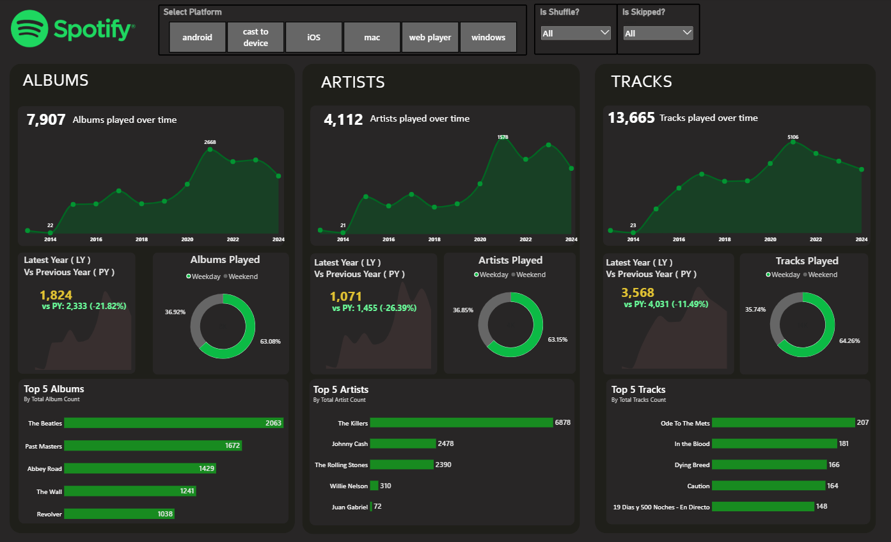
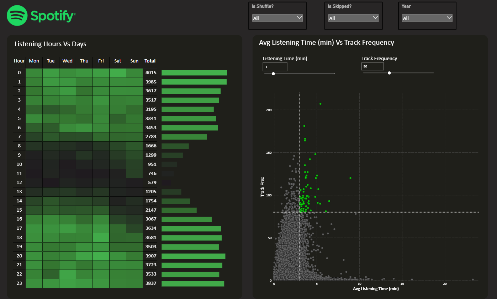
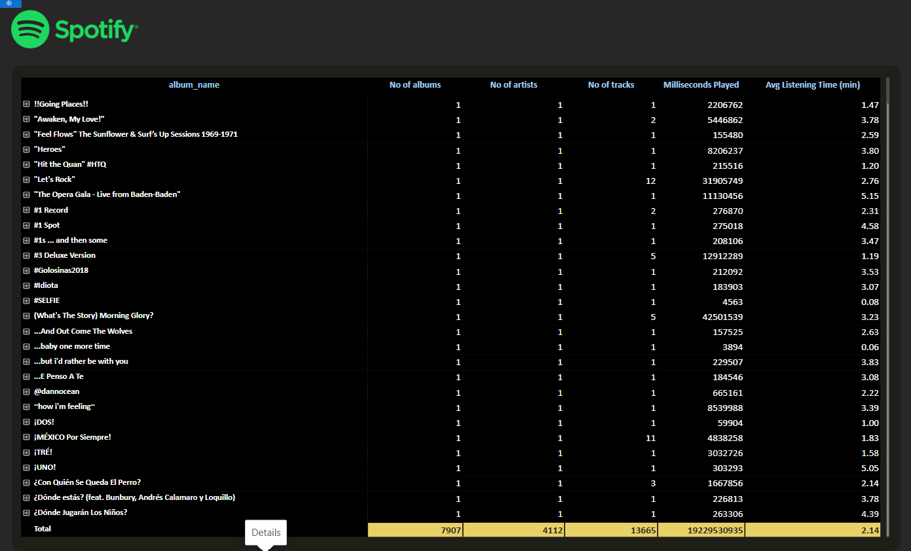

# 🎧 Spotify Data Analysis

<p align="center">
  <strong>Turning Spotify Data into Meaningful Insights</strong>
</p>

<p align="center">
  An exploratory data analytics project focused on understanding music trends, artist performance, track popularity, and patterns hidden within Spotify data.
</p>

<p align="center">
  
  
  
</p>

---

## 📌 Table of Contents

- [Project Overview](#-project-overview)
- [Dashboard Overview](#-dashboard-overview)
- [Business Objectives](#-business-objectives)
- [Key Areas of Analysis](#-key-areas-of-analysis)
- [Project Workflow](#-project-workflow)
- [Tools and Technologies](#-tools-and-technologies)
- [Dataset Overview](#-dataset-overview)
- [Key Questions](#-key-questions)
- [Insights and Findings](#-insights-and-findings)
- [Project Structure](#-project-structure)
- [How to Explore the Project](#-how-to-explore-the-project)
- [Business Applications](#-business-applications)
- [Limitations](#-limitations)
- [Future Improvements](#-future-improvements)
- [Author](#-author)

## 📊 Project Overview

Spotify generates extensive music-related data that can be analyzed to understand track characteristics, artist performance, popularity trends, and changes in music consumption.

The **Spotify Data Analysis** project explores a Spotify dataset to identify meaningful patterns, answer analytical questions, and demonstrate how data analytics can transform raw data into useful information.

The project follows a structured analytical approach, beginning with data exploration and preparation and progressing toward visualization, interpretation, and insight generation.

Rather than simply presenting charts, the objective is to connect data with questions that matter to music listeners, artists, content strategists, and digital music platforms.

## 🖼️ Dashboard Preview

Explore the dashboard screenshots below to see the visualizations and insights developed as part of this project.

**Dashboard Overview**
### Overview


### Listening Patterns


### Details


## 🎯 Business Objectives

The primary objectives of this project are to:

- Understand the distribution and characteristics of Spotify tracks.
- Explore track popularity and artist performance.
- Identify trends and patterns within the available music data.
- Examine relationships between relevant track attributes.
- Present analytical findings through clear, understandable visualizations.
- Apply practical data analysis techniques to a real-world music analytics use case.

## 🔍 Key Areas of Analysis

### 1. Track Performance Analysis
Explore track-level information to understand popularity, track characteristics, and differences between songs.

### 2. Artist Analysis
Examine artist-related metrics to compare performance and identify patterns in the available dataset.

### 3. Music Trends
Investigate time-based patterns when release dates or other relevant temporal fields are available.

### 4. Data Exploration
Inspect distributions, summary statistics, missing values, duplicates, and relationships between relevant variables.

### 5. Data Visualization
Use appropriate charts and visual representations to make patterns, comparisons, and analytical findings easier to understand.

## 🔄 Project Workflow

The project follows a structured data analytics workflow:

1. **Data Collection:** Load the Spotify dataset used in the project.
2. **Data Understanding:** Inspect the dataset structure, columns, data types, and summary statistics.
3. **Data Cleaning:** Identify and address data quality issues where necessary.
4. **Exploratory Data Analysis:** Examine distributions, patterns, and relationships.
5. **Data Analysis:** Perform aggregations, comparisons, and calculations relevant to the analytical objectives.
6. **Visualization:** Present the findings using appropriate charts and visual elements.
7. **Insight Generation:** Interpret the results and identify potential applications.

## 🛠️ Tools and Technologies

The tools below should reflect the technologies actually used in this project.

| Tool | Purpose |
|---|---|
| Data analysis tool | Data exploration and analysis |
| Visualization tool | Charts and analytical reporting |
| Git and GitHub | Version control and project documentation |

If the project uses Python, include the relevant libraries, such as Pandas, NumPy, Matplotlib, or Seaborn. If it uses Power BI, document Power Query, DAX, and the visual types actually implemented.

## 🗂️ Dataset Overview

The project uses Spotify-related data containing information about music tracks and their associated attributes.

Depending on the dataset, relevant fields may include:

| Data Category | Example Fields |
|---|---|
| Track information | Track name, track identifier |
| Artist information | Artist name, artist identifier |
| Popularity | Track popularity score |
| Audio characteristics | Danceability, energy, loudness, tempo |
| Time-related information | Release date, release year |
| Additional metadata | Album, genre, duration |

**Note:** The exact fields depend on the source dataset. Not every field listed above is necessarily present in this project.

The dataset should be credited to its original source, such as Kaggle or Spotify, with the appropriate dataset link added here.

## ❓ Key Analytical Questions

This project can help investigate questions such as:

- Which tracks or artists rank highest according to the available performance metrics?
- How is track popularity distributed across the dataset?
- What patterns appear in music releases over time?
- How do selected audio characteristics vary across tracks?
- Are there observable relationships between track popularity and audio features?
- Which categories or attributes show the most noticeable differences?
- What additional questions could be explored using the available data?

The questions actually answered by the analysis should be prioritized when documenting the final project.

## 💡 Insights and Findings

The final analysis should summarize the most important findings supported by the dataset.

Recommended format:

- **Track Performance:** Highlight the leading tracks based on the metric analyzed.
- **Artist Performance:** Summarize the artists or artist groups that stand out.
- **Popularity Patterns:** Describe the observed distribution of track popularity.
- **Audio Features:** Explain any meaningful relationships found between relevant variables.
- **Temporal Trends:** Summarize release-related patterns, if time-based analysis was performed.

Replace these categories with your actual results and supporting numbers or charts. Avoid treating correlation as proof of causation or assuming that popularity alone measures music quality.

## 📁 Project Structure

The folder structure depends on the files present in the repository. A typical structure for a data analysis project could look like this:

```text
Spotify Analysis/
│
├── data/                 # Dataset files, if included
├── images/               # Dashboard or analysis screenshots
├── notebooks/            # Jupyter notebooks, if used
├── Spotify Analysis.pbix # Power BI report, if used
└── README.md              # Project documentation
```

Update this example to match the actual repository. Remove folders and files that do not exist.

## 🚀 How to Explore the Project

1. Open the [Spotify Analysis project folder](https://github.com/theaditya24/DATA-ANALYTICS-Projects/tree/main/Spotify%20Analysis).
2. Review the available dataset and project files.
3. Open the notebook, report, or dashboard using the appropriate application.
4. Follow the analysis and inspect the visualizations.
5. Review the documented findings and conclusions.

For a Power BI project, open the `.pbix` report in Power BI Desktop. For a Python project, document the Python version, dependency installation steps, and notebook execution instructions.

## 💼 Business Applications

The analytical techniques demonstrated in this project can be relevant to:

- **Music Marketing:** Understanding track and artist performance.
- **Content Strategy:** Exploring patterns that can inform music promotion.
- **Music Discovery:** Comparing tracks using available metadata and audio characteristics.
- **Audience Research:** Investigating popularity patterns within a dataset.
- **Analytical Reporting:** Communicating data-driven findings to non-technical stakeholders.

These are potential applications of the analysis, not claims that the project directly implements Spotify's recommendation systems or measures actual listener behavior.

## ⚠️ Limitations

- Findings depend on the dataset's coverage, quality, and collection methodology.
- Popularity scores may change over time and should be interpreted in context.
- Observational relationships do not establish causation.
- Results may not represent Spotify's entire music catalog or listener population.
- Conclusions should be limited to the fields and records actually analyzed.

## 🔮 Future Improvements

Potential enhancements include:

- Add more detailed visualizations and interactive filtering.
- Expand the analysis with additional music metadata.
- Compare trends across genres, artists, and release periods.
- Develop a dashboard with relevant KPIs and drill-down capabilities.
- Automate data cleaning and recurring analysis.
- Explore predictive modeling or track clustering where suitable data is available.

## 👨‍💻 Author

**Aditya Raj**

Data Analytics | SQL | Python | Power BI | Excel

- GitHub: [@theaditya24](https://github.com/theaditya24)
- Portfolio Projects: [DATA-ANALYTICS-Projects](https://github.com/theaditya24/DATA-ANALYTICS-Projects)

---

<p align="center">
  <strong>Turning Data into Insights, One Track at a Time. 🎵</strong>
</p>
